<div align="center">

# 💀 SpookyBrainrot

### Un escape room de terror para jugar en casa: la tele es la sala, los móviles son los mandos y las llaves están escondidas de verdad por la casa

*«Son las 3:00 AM. Demasiado scroll. Habéis hecho noclip.»*

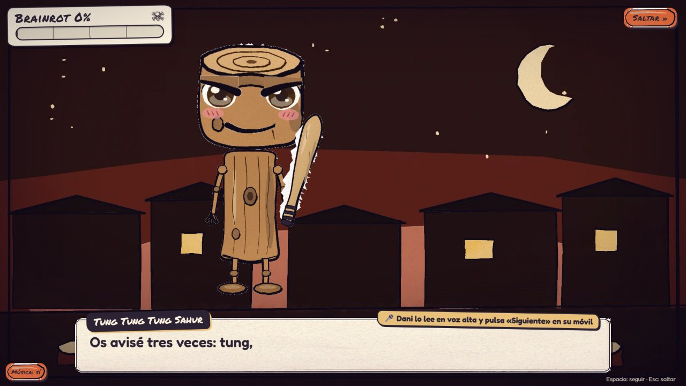


**7 salas · 8 brainrots pintados en acuarela · de 2 a 12 jugadores · ~90 min · 6 canciones · 895 tests · 0 apps que instalar**

</div>

---

## 🤔 ¿Qué es esto?

Un **escape room casero** para una noche con amigos. Una tele hace de sala, cada jugador usa **su propio móvil como mando** (escanea un QR y ya está, sin instalar nada) y, entre sala y sala, toca **levantarse del sofá**: la pista que sale en la tele lleva a un **QR escondido por la casa**, y ese QR abre la puerta siguiente.

Los guardianes de cada sala son los **brainrots italianos** (Tralalero Tralala, Tung Tung Tung Sahur…), pintados en acuarela por código. Cuentan la historia en cinemáticas entre salas, y cada escena la lee en voz alta un jugador elegido al azar.

> Todo corre en un servidor Python dentro de tu red de casa. Sin cuentas, sin nube y sin tiendas de apps. 🏠

<div align="center">
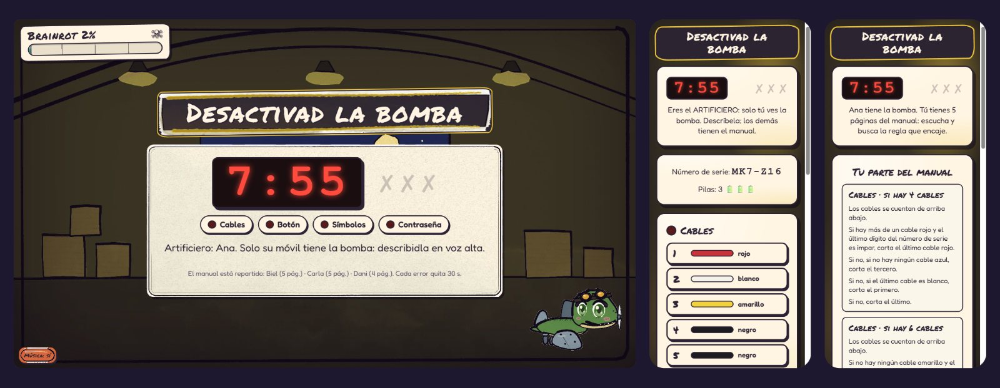
<br><sub>Sala 5: la tele solo enseña el reloj. El móvil del artificiero tiene la bomba y los demás tienen trozos del manual. O habláis, o explota.</sub>
</div>

---

## 👻 La historia

Son las 3:00 AM y el grupo cae en las **Backrooms del Brainrot**: una dimensión liminal hecha de memes podridos donde la Fundación tenía contenidos a los brainrots. La contención ha fallado.

Los móviles son lo único que sigue conectado a la realidad. En cada nivel hay un **Ancla de Realidad** escondida en el mundo real (un QR en la casa), y encontrarla abre el paso al siguiente. Al final espera **Tung Tung Tung Sahur**, que ya os ha llamado tres veces por teléfono.

<div align="center">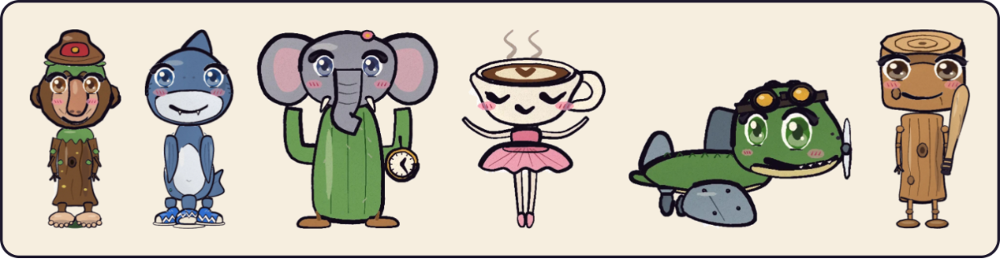</div>

Cada error sube el **medidor de Brainrot**. Cuanto más alto está, más se pudre la imagen (manchas, colores que sangran, un viñeteado que late), y al final decide cómo acaba la noche:

| Brainrot% final | Final |
|---|---|
| menos de 40 % | 🏃 Escapáis. |
| de 40 a 75 % | 👀 Escapáis… pero algo vino con vosotros. |
| más de 75 % | 🧠 Os convertís en brainrots. |

Además hay **QR trampa** escondidos por la casa: escanear uno despierta a un brainrot en la tele (jumpscare incluido) y castiga una sola vez por partida. La segunda vez, solo se ríe.

---

## 🚪 Las salas

Cada sala tiene dos mitades: **el puzzle en la tele revela una pista, y la pista lleva a un QR escondido en la casa.** La regla de oro es la **información repartida**: la tele enseña lo común y cada móvil guarda un fragmento privado, así que nadie lo resuelve solo.

| # | Nivel | Guardián | La prueba |
|:---:|---|---|---|
| 0 | Prólogo: Noclip | La Fundación | **Agarraos fuerte**: todos con el dedo en el móvil a la vez durante 5 s. Sirve para aprender el mando. |
| 1 | Nivel 0 | Brr Brr Patapim | **Plataformas cooperativas** en tiempo real, en 4 niveles: torre humana, botón pesado, plataforma que solo sale con todos a bordo y una llave que hay que llevar a la puerta. |
| 2 | Las Piscinas | Tralalero Tralala | **Un, dos, tres… ¡Tralalero!** Se nada solo en verde. Hay falsos giros, y quien ya ha llegado puede distraerle. |
| 3 | Centro comercial de las 3 AM | Lirilì Larilà | **Contad las formas**: a cada uno le toca una forma y solo tiene −1 y +1. Tres rondas, y en la última las formas se mueven. |
| 4 | Sitio-19 | Ballerina Cappuccina | **Trivia de las Backrooms** por consenso: la respuesta solo se envía cuando todos votan lo mismo. |
| 5 | Hangar abandonado | Bombardiro Crocodilo | **Desactivad la bomba**: cables, botón, símbolos y contraseña. Un móvil tiene la bomba y el manual está repartido entre los demás. |
| 6 | La salida | Tung Tung Tung Sahur | **5 niveles largos con scroll**: tambores, ascensores, botones para uno… Si uno cae, volvéis todos al principio. Y en el último, Sahur os persigue. |

<table>
<tr>
<td width="50%">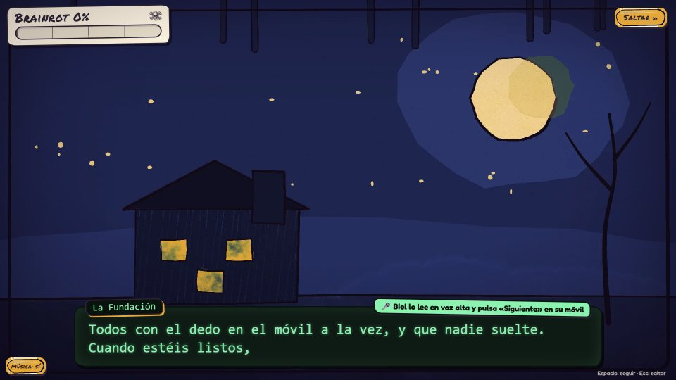<br><sub><b>Prólogo.</b> La Fundación explica las anclas y el Brainrot%. Un jugador lo lee en voz alta.</sub></td>
<td width="50%">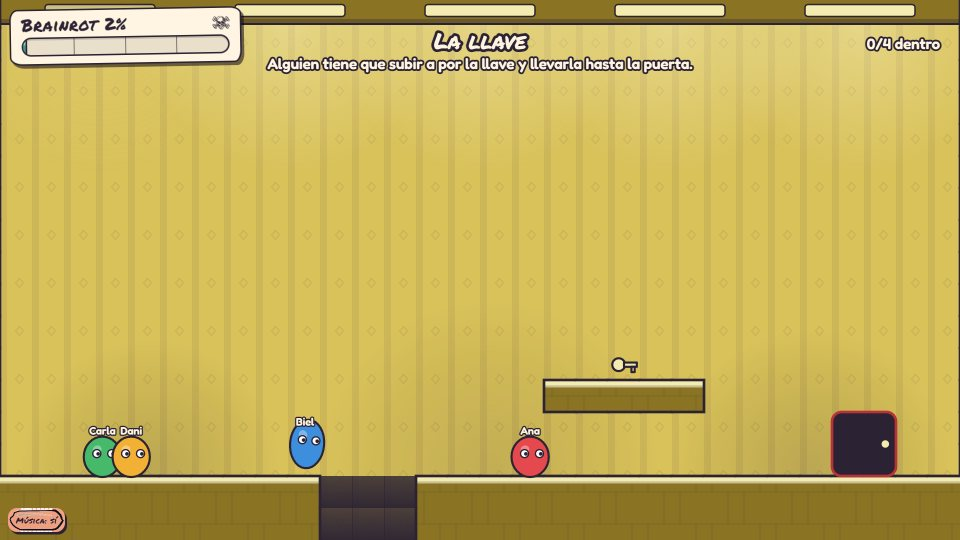<br><sub><b>Sala 1 · Nivel 0.</b> Cada jugador es un bichito y la tele hace la física.</sub></td>
</tr>
<tr>
<td>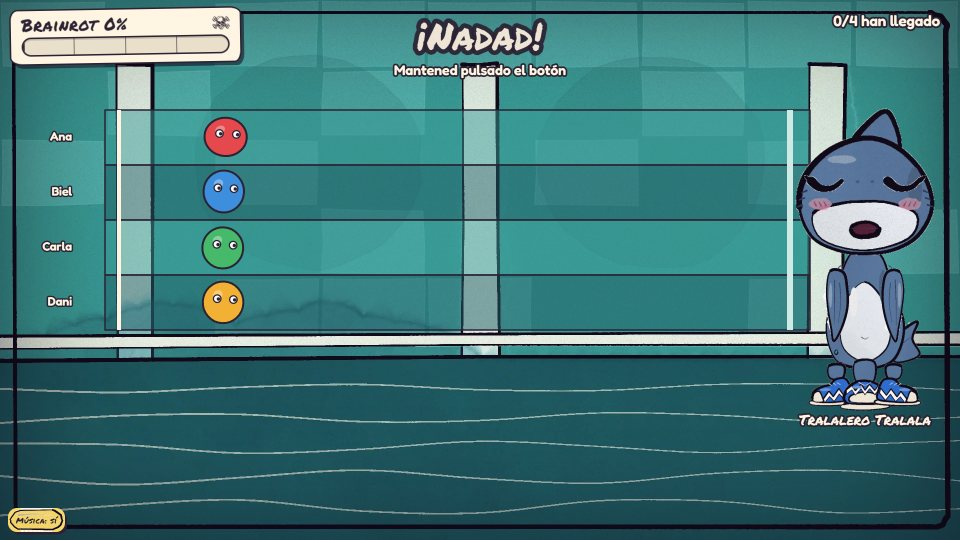<br><sub><b>Sala 2 · Las Piscinas.</b> Tralalero se da la vuelta… o hace como que se la da.</sub></td>
<td>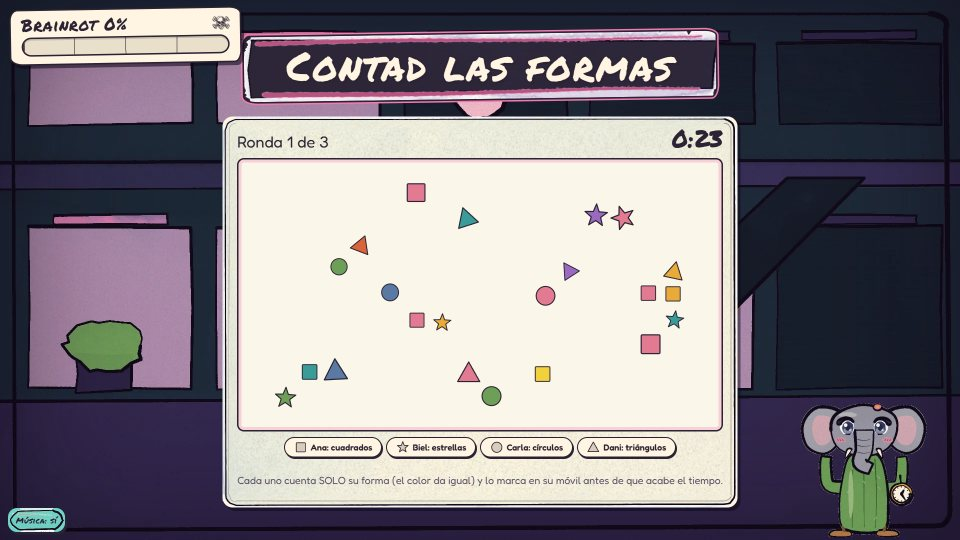<br><sub><b>Sala 3 · Centro comercial.</b> El color da igual: solo cuenta la forma.</sub></td>
</tr>
<tr>
<td>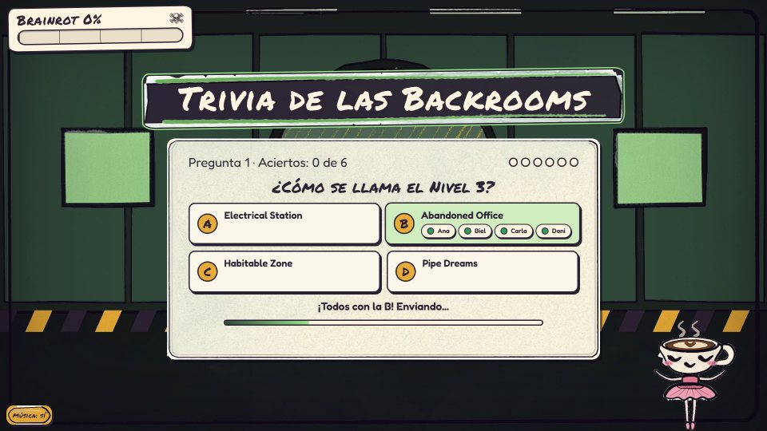<br><sub><b>Sala 4 · Sitio-19.</b> «¡Todos con la B! Enviando…»</sub></td>
<td>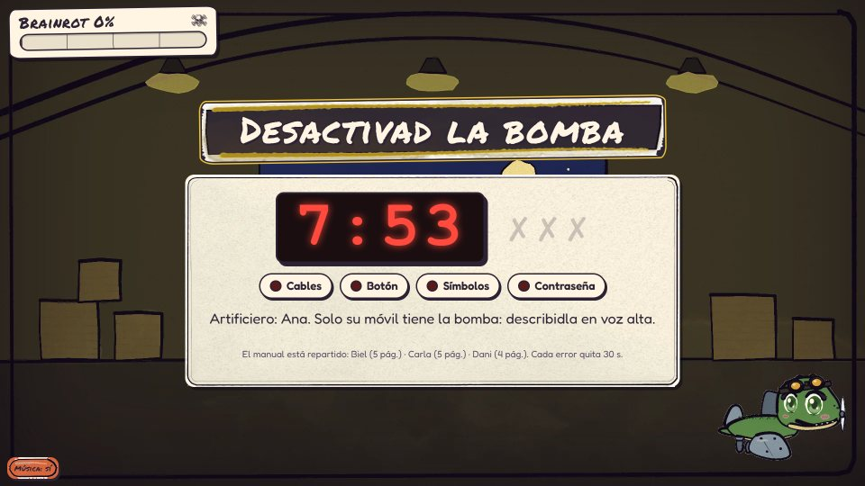<br><sub><b>Sala 5 · Hangar.</b> 8 minutos, 3 errores y ¡BUM!</sub></td>
</tr>
<tr>
<td>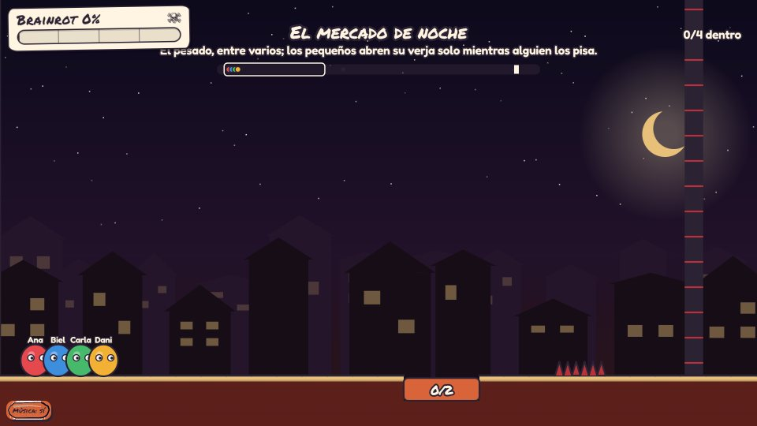<br><sub><b>Sala 6 · La salida.</b> La cámara sigue al grupo, y nadie puede quedarse atrás.</sub></td>
<td>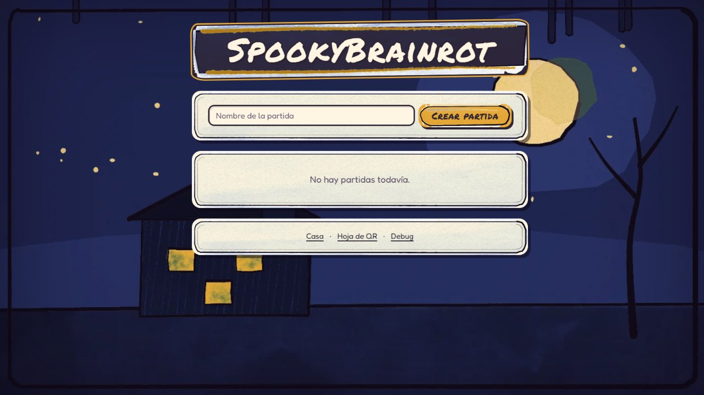<br><sub><b>Portada.</b> Crear, continuar y borrar partidas.</sub></td>
</tr>
</table>

Todo el diseño, sala por sala y con sus números, está en **[`GAME_DESIGN.md`](GAME_DESIGN.md)**.

---

## 🎮 Cómo se juega una noche

1. **Arranca el servidor** en un ordenador de casa ([ver abajo](#-ponerlo-en-marcha)).
2. **Escribe las pistas** en `/admin/house`: una por ancla y, si quieres, el escondite. Vale para todas las partidas.
3. **Imprime los QR** en `/admin/qr-sheet`: una tarjeta por sala, en orden de juego y con un código de 4 letras por si la cámara no lee. `/admin/qr-key` es la chuleta del anfitrión (con spoilers).
4. **Esconde las tarjetas.** La de la Sala 6 es la salida.
5. **Abre `/` en el ordenador conectado a la tele**, crea una partida y toca la pantalla para empezar.
6. **Los jugadores escanean el QR del lobby** con el móvil, ponen su nombre y a jugar.

> 💡 Quien esconde los QR sabe dónde están. Lo ideal es que esa persona haga de *game master* y lleve la tele, o que los esconda otra.

---

## ⚙️ Cómo funciona por dentro

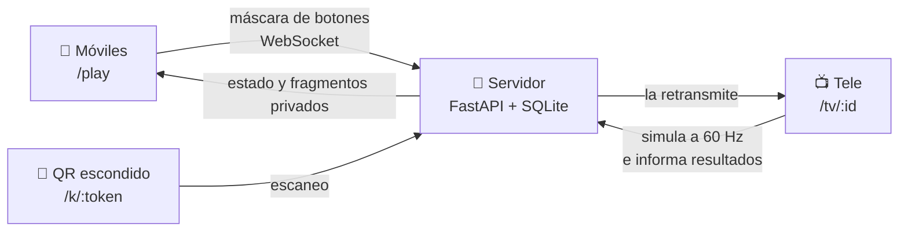

- **El servidor manda y la tele simula.** Las reglas viven en un dominio puro ([`app/core`](app/core)) con cada sala como plugin ([`app/puzzles`](app/puzzles)) y una capa async por partida ([`app/runtime`](app/runtime)). En las salas en tiempo real, cada móvil envía solo una máscara de bits (izquierda 1, derecha 2, saltar 4, acción 8) y el servidor la retransmite a la tele sin pasar por el bloqueo de la partida. La tele simula a 60 Hz e informa de resultados con `epoch` y nivel, así que un informe viejo se ignora.
- **Cada móvil ve solo lo suyo.** Su forma en la sala 3, sus páginas del manual en la 5, la bomba si es el artificiero. Los spoilers del anfitrión nunca llegan ni a la tele ni a los móviles.
- **Sin bundler.** El frontend son módulos ES servidos tal cual. El simulador de plataformas es JavaScript puro y determinista, y se prueba con `node --test`.
- **QR que no caducan.** Los tokens se generan una sola vez en el primer arranque, se guardan en la base de datos y no hay ningún endpoint para regenerarlos. Se pueden imprimir y guardar en un cajón para la próxima vez.
- **Cámara dentro del juego.** Con HTTPS o en `localhost` hay visor en vivo. En la red de casa por HTTP normal, el navegador no deja usar la cámara en vivo, así que el botón abre la app de cámara, el jugador hace una foto y el juego la lee (con `BarcodeDetector` si existe y, si no, con jsQR).

Los niveles de plataformas son mapas ASCII ([`levels.js`](static/puzzles/coop_platformer/levels.js)): `#` suelo, `S` salida, `D` puerta, `B` campana, `G` verja, `b` botón pesado, `T` tambor, `^` pinchos…

```js
{
  id: "boton",
  title: "El botón pesado",
  hint: "Pisad el botón entre varios hasta que la verja ceda.",
  rows: rows(
    WALL,
    Array.from({ length: 13 }, () => `#${".".repeat(15)}G${".".repeat(14)}#`),
    `#${".".repeat(15)}G${".".repeat(10)}DD..#`,
    `#.SSSSSS${".".repeat(8)}G${".".repeat(10)}DD..#`,
    `#########bbb${"#".repeat(20)}`,
    WALL,
  ),
},
```

Y las cinemáticas, un guion ([`script.js`](static/js/story/script.js)) que la tele interpreta con voces de pitidos sintetizados por letra, como en los juegos de rol clásicos:

```js
intro_6: {
  title: "Sala final", cast: ["sahur"],
  beats: [
    card("Sala final · La salida de Sahur", { sfx: "warn" }),
    say("fundacion", "Tung. Tung. Tung. Perdemos la señal de la Fundación... Estáis solos.", { shake: true }),
    say("sahur", "Os avisé tres veces: tung, tung, tung. La gente educada contesta.", { emote: "angry" }),
    // ...
  ],
},
```

### 🎨 La acuarela

La tele, el móvil y la portada se pintan al estilo «libro de cuentos de terror» en el propio navegador. [`static/js/art/`](static/js/art) pinta **una vez** unas placas (fondo, panel, botón, cartel, marco, salpicón) con p5.js + p5.brush y las publica como imágenes WebP en variables CSS. El texto y los controles son DOM normal, así que se leen y se pulsan como cualquier web.

- El **Brainrot%** (`html[data-rot]`, de 0 a 5) degrada solo el fondo: manchas, sangrado, un viñeteado que late y un temblor más rápido. El texto no se mueve ni pierde contraste.
- **Interruptor de emergencia:** `?art=off` en cualquier URL usa papel 2D y lavados CSS, sin WebGL. También entra solo si no hay WebGL2, si se pierde el contexto o si la primera placa tarda más de 4 s.
- Patapim, Tralalero y Sahur tienen **rig**: la boca se mueve con las vocales mientras hablan, y los demás dan saltitos. [`/static/dev/brainrots.html`](static/dev/brainrots.html) pinta a los ocho y descarga cada pose en PNG transparente.

### 🤖 Bots que juegan solos

**`/admin/demo`** monta una partida entera en una sola pantalla: la tele y cuatro móviles (Ana, Biel, Carla y Dani) en iframes, con bots que juegan cada sala por el mismo camino que un jugador real. Las capturas de este README salen de ahí. Los bots también juegan en los tests: [`platformer_sahur.test.mjs`](tests_js/platformer_sahur.test.mjs) comprueba que los cinco niveles de Sahur se pueden pasar con 2 y con 12 jugadores, sin caerse y sin que nadie se salga de la pantalla.

---

## 🚀 Ponerlo en marcha

**Necesitas:** Python 3.10 o superior. Nada más para jugar.

```bash
python -m venv .venv
.venv/Scripts/activate        # Linux/macOS: source .venv/bin/activate
pip install -r requirements.txt
python tools/fetch_audio.py   # descarga los efectos de sonido de Mixkit (ver abajo)
cp env.example .env           # copia la plantilla y edítala (ver tabla)
python main.py
```

> 🔊 Los efectos y ambientes de Mixkit **no vienen en el repo**, porque su licencia no permite redistribuirlos junto al código. `tools/fetch_audio.py` los descarga de Mixkit y comprueba su sha256. Si te lo saltas, el juego funciona igual: cada efecto usa su versión sintetizada y los ambientes no suenan.

Abre `http://localhost:8000` en el ordenador de la tele. Los móviles tienen que estar en la **misma red**: el QR del lobby lleva a la IP local del servidor.

> La plantilla se llama `env.example` (no `.env.example`). Cópiala a `.env`; el fichero `.env` está en `.gitignore`.

| Variable | Por defecto | Para qué |
|---|---|---|
| `SERVER_PORT` | (vacía) | Puerto del servidor. Tiene prioridad. |
| `PORT` | (vacía) | Puerto alternativo. Si ninguno es válido, se usa `8000`. |
| `PUBLIC_URL` | IPv4 local automática | URL que va dentro de los QR. Vacía, detecta la IPv4 del servidor con el puerto configurado; `localhost` se sustituye por la IPv4 local. |
| `DB_PATH` | `data/spooky.db` | Base de datos SQLite (la carpeta se crea sola). |
| `ADMIN_KEY` | (vacía) | Si se define, protege `/admin/*` y `/api/house*`. Vacía = abierto. |
| `ADMIN_PLAYER` | `Roger` | El jugador con este nombre ve el menú de admin en su móvil (sin distinguir mayúsculas). **Pon el tuyo.** |
| `MIN_PLAYERS` | `2` | Jugadores conectados mínimos para salir del lobby. |

Las variables del entorno (por ejemplo, las de un panel de hosting) tienen prioridad sobre `.env`.

> ⚠️ **Haz copia de `data/spooky.db` y no borres nunca la carpeta `data/`.** Ahí están las partidas guardadas y los tokens de los QR que ya has impreso: si se pierde, hay que reimprimirlos todos. Y si cambias `PUBLIC_URL` después de imprimir, los QR seguirán apuntando a la dirección antigua.

<details>
<summary>🦖 Desplegar en Pterodactyl</summary>

1. Crea el servidor con un egg/yolk de **Python 3.10 o superior**.
2. Sube el proyecto a la raíz del servidor.
3. Instalación: `pip install -r requirements.txt` y `python tools/fetch_audio.py`.
4. Comando de arranque: `python main.py`.
5. Puerto: el servidor lee `SERVER_PORT` y, si no existe, `PORT`. Asegúrate de que el puerto asignado en el panel llega en `SERVER_PORT`.
6. Define `PUBLIC_URL` con la dirección a la que se conectarán los móviles (por ejemplo, `http://192.168.1.50:25565`). Los QR impresos la contienen.
7. Opcional (y recomendable si el servidor se ve desde internet): define `ADMIN_KEY`.

</details>

<details>
<summary>🔑 ADMIN_KEY</summary>

Con `ADMIN_KEY` definida, abre una vez `/admin/house?key=TU_CLAVE`: se guarda la cookie `sb_admin` y el resto de páginas de administración funcionan sin repetir la clave. Sin clave, la respuesta es 401; con clave incorrecta, 403. Con `ADMIN_KEY` vacía todo está abierto: está bien en casa, pero defínela si lo publicas en internet.

</details>

<details>
<summary>🛠️ Modo debug del anfitrión</summary>

Para probar el juego sin jugar todas las salas:

- **En la tele:** `Shift+D` abre y cierra el cajón de debug. Está oculto por defecto y, mientras está abierto, aparece una etiqueta roja «debug».
- **Desde tu móvil:** `/admin/debug` (enlazado desde la portada) tiene los mismos controles sin enseñar nada en la tele.
- **Menú de admin del jugador:** si juegas con el nombre de `ADMIN_PLAYER`, tu móvil muestra un botón «Admin» con los mismos controles para tu partida, sin spoilers (tú también juegas), más «Saltar escena» y «Refrescar tele». El móvil se identifica con su token de jugador, que solo abre la API de debug de su propia partida, así que funciona aunque haya `ADMIN_KEY`.
- **Controles:** saltar a cualquier sala y fase, completar el puzzle, mover el Brainrot%, lanzar eventos de prueba (jumpscare, salpicón, ronda fallida, ancla encontrada) y reiniciar al lobby conservando a los jugadores. En la fase de puzzle también se puede saltar a cada nivel o ronda, con una línea de spoilers solo para el anfitrión.
- **API:** `GET /admin/api/games`, `GET|POST /admin/api/games/<id>/debug[/jump|complete|brainrot|event|reset]`.

</details>

<details>
<summary>📷 Detalles del escaneo de QR</summary>

- **¿Qué partida abre un QR?** La del mando, si ese navegador ya está en `/play` (cookie). Si no, la única partida en curso. Si hubiera varias, la página pide elegir.
- **Un ancla solo funciona si su nivel está activo.** Si la encuentran antes: *«Esta ancla aún duerme…»*, sin castigo.
- **Cámara del iPhone:** si el QR se abre en el navegador integrado de la cámara, la cookie del jugador puede no estar disponible y la página pedirá elegir partida si hay varias. Lo ideal es abrirlo en el Safari o Chrome donde se unió el jugador.
- **Reconexiones:** si un móvil pierde la sesión y vuelve a unirse con el **mismo nombre**, recupera su plaza (no distingue mayúsculas ni espacios de más).

</details>

<details>
<summary>💾 Partidas guardadas (formato v3)</summary>

El guardado va por la versión 3, que incluye el número de sala (la v3 renumeró las salas sin huecos: la bomba pasó de 6 a 5 y Sahur de 7 a 6). Las partidas antiguas se migran solas, pero **una partida v3 no se puede cargar con código antiguo**. Si vuelves atrás, borra las partidas desde la portada; no toques `data/` a mano.

</details>

### 🧪 Tests

```bash
pip install -r requirements-dev.txt
python -m pytest
```

Son 745 tests de pytest y 150 de `node:test` para el simulador, la música, los sprites y los bots. `pytest` ya lanza los de JavaScript con un envoltorio ([`tests/test_js_sim.py`](tests/test_js_sim.py)) que se los salta si no hay `node` en el PATH. Node.js solo hace falta para desarrollar; el juego no lo necesita.

```bash
node --test tests_js/*.test.mjs
```

---

## 🗂️ Estructura

```
main.py                   punto de entrada: python main.py
app/core/                 dominio puro: partida, motor, QR, medidor de Brainrot
app/puzzles/              cada sala es un plugin
app/runtime/              capa async por partida (reloj, bloqueo, tele conectada)
app/db/                   SQLite: partidas, casa y tokens de QR
app/web/                  HTTP, WebSocket, páginas de admin y debug
static/js/tv/             la tele: pantallas, música, efectos y cinemáticas
static/js/play/           el mando del móvil y el escáner de QR
static/js/art/            la acuarela: placas, rigs y sprites de los brainrots
static/js/story/          el guion de las cinemáticas
static/js/sim/            bucle de simulación compartido
static/puzzles/<sala>/    la tele y el mando de cada sala
static/audio/             música, créditos y la lista de efectos de Mixkit (mixkit.json)
static/vendor/            librerías y fuentes autoalojadas, con su sha256
music/                    las seis canciones originales de Suno y sus fichas
tools/fetch_audio.py      descarga los efectos de Mixkit y comprueba su sha256
tests/  tests_js/         pytest y node:test
GAME_DESIGN.md            el diseño completo, sala por sala
INSTRUCTIONS.md           el encargo original, tal cual
```

---

## 🙏 Inspiración y créditos

### 🎨 El pincel: ClaudeAnimationBase, de John Heibel

**[github.com/JohnHeibel/ClaudeAnimationBase](https://github.com/JohnHeibel/ClaudeAnimationBase)** (MIT) es un kit para animar dibujos pintados a mano con Claude, sobre p5.js + p5.brush. [`static/js/art/engine.js`](static/js/art/engine.js) es una adaptación de su `core.js`, y la licencia original está en [`static/vendor/claude-animation-base/`](static/vendor/claude-animation-base/LICENSE).

Otro proyecto del autor de este juego, con la misma técnica de acuarela: **[No me creas](https://github.com/RogerMinemu/no-me-creas-claude)**, el videoclip que Claude programó cuadro a cuadro.

### 🎵 Sonido

- **Seis canciones instrumentales generadas con [Suno](https://suno.com)**, una por ambiente (lobby, Nivel 0, piscinas, contención, Sahur y finales). Las fichas con los prompts de estilo están en [`music/`](music/README.md).
- **Kevin MacLeod** ([incompetech.com](https://incompetech.com)), bajo CC BY 4.0: «Local Forecast - Elevator» (centro comercial), «Thinking Music» (trivia) y «Sneaky Snitch» (búsqueda de QR). La pantalla final muestra la atribución.
- **Efectos y ambientes de [Mixkit](https://mixkit.co)**, bajo la Mixkit Sound Effects Free License. No vienen en el repo: los descarga [`tools/fetch_audio.py`](tools/fetch_audio.py).

Fuentes y licencias de cada archivo: [`static/audio/CREDITS.md`](static/audio/CREDITS.md).

### 👾 El universo

- Los **brainrots italianos**, los memes de 2025 que dan nombre al juego.
- **Las Backrooms**: la creepypasta nacida en 4chan en 2019, su wiki y la serie de Kane Pixels.
- **La Fundación SCP**, de donde salen la contención fallida y el Sitio-19.
- **Keep Talking and Nobody Explodes**, la inspiración de la bomba con el manual repartido.

### 🧰 Herramientas

[FastAPI](https://fastapi.tiangolo.com) · [Uvicorn](https://www.uvicorn.org) · [segno](https://github.com/heuer/segno) (QR) · [p5.js](https://p5js.org) · [p5.brush](https://github.com/acamposuribe/p5.brush) · [jsQR](https://github.com/cozmo/jsQR) · fuentes [Permanent Marker](https://fonts.google.com/specimen/Permanent+Marker) (Apache-2.0) y [Fredoka](https://fonts.google.com/specimen/Fredoka) (OFL-1.1). Todo autoalojado en [`static/vendor/`](static/vendor/VENDOR.md), sin CDN.

---

## 🤝 Humano + IA

**El humano dirigió; la IA ejecutó.** El encargo original cabe en un párrafo ([`INSTRUCTIONS.md`](INSTRUCTIONS.md)): un escape room web en Python, móviles como mandos, objetos escondidos por la casa, brainrots, acuarela y canciones de Suno. A partir de ahí, el juego se construyó con **Claude Code** y un flujo de *Spec-Driven Development*: propuesta, especificación, diseño, tareas, implementación y verificación para cada cambio grande.

Después hubo una partida de prueba de verdad, y lo que pasó en el salón cambió el juego: la sala de Sahur cambió su juego de memoria por plataformas (fue lo que más gustó), las cinemáticas pasaron a leerse en voz alta por un jugador, los QR ganaron un código de 4 letras por si la cámara no lee, en las piscinas se nada 4 veces más despacio y la bomba pasó a tener 8 minutos.

| | Humano | Claude | Suno |
|---|:---:|:---:|:---:|
| El encargo y la visión | ✅ | | |
| Diseño de salas y guion ([`GAME_DESIGN.md`](GAME_DESIGN.md)) | ✅ (dirige y corrige) | ✅ | |
| Código: servidor, salas, tele, móviles y tests | | ✅ | |
| Brainrots en acuarela y cinemáticas | ✅ (referencias) | ✅ | |
| Música | ✅ (elige las tomas) | | ✅ |
| Jugar la partida de prueba y decidir qué cambiar | ✅ | | |
| Aplicar los cambios del playtest | | ✅ | |

---

## 📄 Licencia

- **El código y los textos originales** (`app/`, `static/` salvo `vendor/` y `audio/`, `tests/`, `tests_js/`, `main.py` y la documentación) se publican bajo **[MIT](LICENSE)**.
- **Las librerías y fuentes de `static/vendor/`** conservan su licencia: p5.js (LGPL-2.1, sin modificar), p5.brush (MIT), jsQR (Apache-2.0), Permanent Marker (Apache-2.0) y Fredoka (OFL-1.1). El detalle y los sha256 están en [`VENDOR.md`](static/vendor/VENDOR.md).
- **`static/js/art/engine.js`** es una adaptación de ClaudeAnimationBase (MIT, © 2026 John Heibel).
- **El audio** no es MIT. Los efectos de Mixkit no se redistribuyen aquí (los descarga `tools/fetch_audio.py`), los temas de Kevin MacLeod son CC BY 4.0 y las canciones de Suno están sujetas a los términos de Suno.
- Los brainrots son memes de internet. Este es un proyecto de fans, sin relación con sus creadores, con las Backrooms ni con la wiki SCP.

<div align="center">

---

*Tung. Tung. Tung.* **¿Quién no ha contestado al teléfono?** 📞

</div>

---

<details>
<summary>🇬🇧 English summary</summary>

**SpookyBrainrot** is a horror escape room to play at home with friends (in Spanish). A TV is the room, every player's phone is a controller (scan a QR code, nothing to install), and between rooms you have to get off the couch: the clue on the TV leads to a QR code hidden somewhere in the house, which unlocks the next room.

There are 7 rooms, each guarded by an "Italian brainrot" meme painted in watercolor by code (p5.js + p5.brush): a co-op platformer simulated by the TV at 60 Hz, a red-light-green-light swim race, a shape-counting game, a consensus trivia about the Backrooms, a *Keep Talking*-style bomb with the manual split across the phones, and a five-level scrolling escape from Tung Tung Tung Sahur. Mistakes raise the Brainrot meter, which rots the image and picks one of three endings.

The server is Python (FastAPI + WebSocket + SQLite) and runs on your home network. The frontend is plain ES modules, with no bundler. Run `pip install -r requirements.txt && python tools/fetch_audio.py && python main.py` and open `http://localhost:8000` on the TV computer. `/admin/demo` plays a whole game with bots.

The code is MIT. Vendored libraries, fonts and audio keep their own licenses; the Mixkit sound effects are not redistributed here and `tools/fetch_audio.py` downloads them (see [LICENSE](LICENSE) and [`static/audio/CREDITS.md`](static/audio/CREDITS.md)). Built with Claude Code, directed by a human.

</details>
